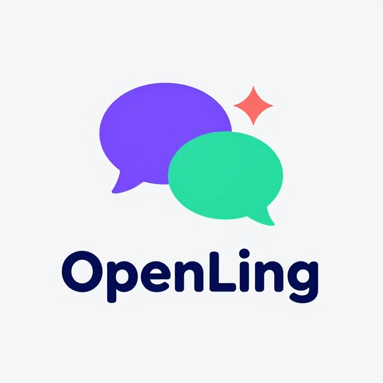

# 🌍 OpenLing — The Open Way to Learn Languages

<p align="center">
  
</p>

> **OpenLing** is a 100% free, open-source language learning platform — starting with **English for Arabic speakers**, built for the world.  
> Learn vocabulary, grammar, writing, speaking, and reading with an AI that talks to you, corrects your mistakes in real time via mic and voice, and tailors everything to *your* goals.

[](https://opensource.org/licenses/MIT)
[](https://vuejs.org/)
[](https://hono.dev/)
[](https://pnpm.io/)
[](https://www.docker.com/)

---

## ✨ About

**OpenLing** is a modern, open-source language learning platform. It's **Arabic-first** today (English for Arabic speakers), and **built for the world** — more languages coming soon.

I'm building it primarily for the **Egypt State Award for the Young Creator** 🏆, but it's also a fully open-source project and portfolio piece.

**Why OpenLing?**
- 🤍 **100% free & open source** — forever.
- 🤖 **AI that talks with you** — speak into the mic, get real-time corrections on your pronunciation, grammar, and phrasing.
- 🎯 **Personalized for you** — your own words, grammar lessons, reading articles, and writing tasks, all tailored to your goals.
- 🌍 **Arabic-first, built for the world.**
- 🐳 **Self-hostable** with Docker.

---

## 🚀 Features (in development)

- 📚 **Vocabulary** — personalized word bank
- 📝 **Grammar** — tailored lessons & exercises
- 🎙️ **Speaking** — talk with AI via mic, get corrected in real time
- ✍️ **Writing** — practice with AI feedback
- 📖 **Reading** — articles matched to your goals
- 🤖 **AI Assistant** — conversation, correction, and guidance
- 👥 **Community** — learn together
- 🌐 **More languages** — beyond Arabic/English, coming soon

---

## 🛠️ Tech Stack

**Frontend (`client/`)** — Vue.js 3, Vue Router, Pinia, Sass  
**Backend (`server/`)** — Hono.js, JavaScript  
**Tooling** — pnpm, Docker

---

## 📁 Project Structure

```
openling/
├── client/ # Frontend (Vue.js)
├── server/ # Backend (Hono.js)
├── public/ # Static assets (logo, etc.)
├── LICENSE # MIT License
└── README.md
```

---

## 🚦 Getting Started

**Prerequisites:** Node.js (v18+), pnpm, Docker (optional)

```bash
git clone https://github.com/omarhossdev/openling.git
cd openling/client # frontend
pnpm dev
```

---

## 🤝 Contributing

OpenLing is currently a **solo project** being developed for the **Egypt State Award for the Young Creator** 🏆, so I'm not accepting code contributions (PRs) just yet — the project needs to stay my own work for the competition.

**After the award, the doors open!** 🚪 Contributions will be very welcome.

In the meantime, you can still help a lot:
- ⭐ **Star the repo** — it means a lot!
- 🐛 **Report bugs** or 💡 **suggest features** via [Issues](https://github.com/omarhossdev/openling/issues)
- 💬 **Share feedback** or ideas
- 📣 **Tell others** about OpenLing

Thanks for understanding and for the support! 🤍

## 📄 License

**MIT License** — see [LICENSE](LICENSE).

---

## 🌍 Vision

> **"The open way to learn languages."**

Education should be free, accessible, and community-driven. OpenLing starts with English for Arabic speakers — and grows to serve learners everywhere.

---

<p align="center">
  Made with 🤍 for learners everywhere.
</p>